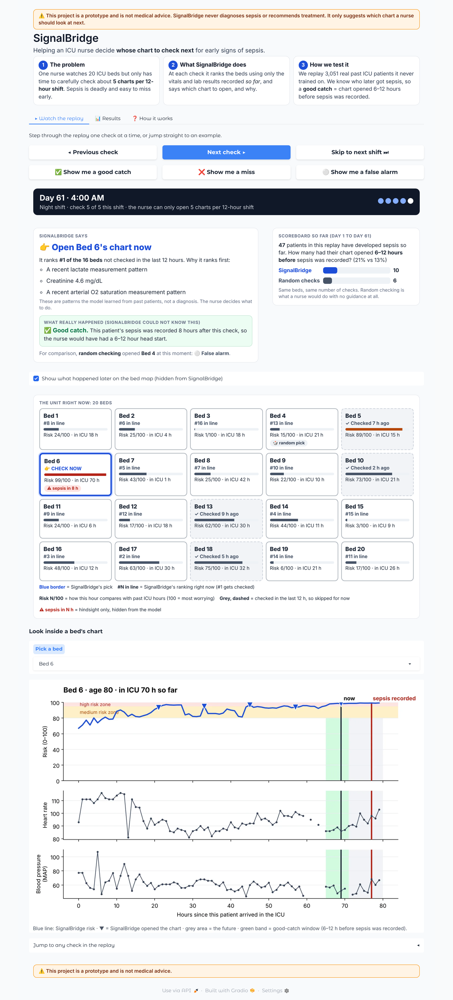

# Septris

**A safety-aware sepsis review queue for a capacity-limited ICU.**
Veritas AI International High School Hackathon 2026 · AI + Health track ·
Team: Miheer Parasnis, Aaron Qin, Reyansh Maheshwari.

> **This project is a prototype and is not medical advice.**
> Septris does not diagnose sepsis or recommend treatment. It only
> orders a human review queue.



## The problem and the user

A tele-ICU nurse or ICU charge nurse running a sepsis review round across 20
beds has time for about **5 deep chart reviews per 12-hour shift**. At each
review slot the question is: *of the patients I haven't just reviewed, whose
chart should I open now?* Sepsis alerts that fire on everyone are useless here.
A widely used commercial sepsis model, when validated externally, missed about
two-thirds of sepsis cases while alerting on 18% of hospitalizations (Wong et
al., *JAMA Internal Medicine*, 2021).

Septris fills a fixed number of review slots using only data recorded up
to that hour, and explains each pick with a fixed-template "why now" line.

## Headline result

**Final Septris** is a calibrated LightGBM + temporal GRU blend: both models are Platt-calibrated on one patient-disjoint validation slice, and the blend weight is chosen on a second validation slice (**20% LightGBM + 80% GRU** for the Hospital A model, **10% + 90%** for Hospital B; `scripts/09_validated_ensemble.py`).

With **5 chart reviews per 20-bed, 12-hour shift**, on held-out test patients the model never saw (`scripts/19_five_review_final.py`):

| | Hospital A (238 eligible) | Hospital B (134 eligible) |
| --- | --- | --- |
| **Septris, home model** | **33.1%** (28.5–39.2) | **39.3%** (29.2–46.5) |
| Septris, model from the other hospital | 26.1% (22.6–33.1) | 28.4% (24.1–40.5) |
| Temporal GRU alone | 33.4% (27.8–38.1) | 36.0% (29.7–44.4) |
| LightGBM alone | 32.9% (27.9–39.8) | 35.1% (26.5–43.0) |
| SIRS ranking | 17.9% (14.8–24.0) | 20.9% (16.2–30.8) |
| Random review, same budget | 15.6% (9.7–18.1) | 13.7% (8.3–19.0) |

Share of eligible sepsis patients reviewed **6–12 hours before recorded onset**; mean of 5 admission orders, 95% intervals from 200 patient-level bootstrap replicates. Septris catches about **2.1×** (A) and **2.9×** (B) as many cases early as random review with the same five reviews, and nearly twice as many as SIRS. About 4.5 (A) and 4.7 (B) of every 5 reviews still go to a patient with no onset in the next 12 hours, because only ~6–9% of ICU patients develop sepsis. At Hospital A the GRU alone is level with the blend; at Hospital B the blend is ahead; at the unseen hospital the GRU alone is about two points ahead. All of these gaps are inside the intervals.

**If a nurse only has 3 reviews per shift** (the budget written into our pre-registration): Septris caught **26.6%** (21.7–32.6) at Hospital A and **31.6%** (20.9–36.9) at Hospital B, against 8.0% and 9.3% for random review and 12.5% and 16.9% for SIRS; at the unseen hospital, 22.6% (B → A) and 24.0% (A → B). The blend weight was tuned at 3 reviews on validation patients before any test patient was scored.

The public data name the sources only as Hospital A and Hospital B. The web demo and its data (`scripts/05_app_artifacts.py`, `13_web_export.py`) use this blend at 5 reviews per shift. An earlier "higher of the two scores" mix is described in [docs/model_mix.md](docs/model_mix.md) as exploratory history.

### Pre-registered version 1 (LightGBM, 3 reviews per shift)

The original pre-registered model and budget, kept for the record:

| | Hospital A | Hospital B |
| --- | --- | --- |
| **LightGBM, home model** | **25.1%** (21.2–31.2) · 60 of 238 | **26.3%** (19.8–33.8) · 35 of 134 |
| LightGBM from the other hospital | 15.5% (12.1–21.0) | 23.7% (17.0–29.6) |
| SIRS ranking | 12.5% (8.6–18.1) | 16.9% (10.6–22.6) |
| Random review, same budget | 8.0% (5.3–12.6) | 9.3% (4.2–13.7) |

- **Beats equal-budget random review:** +17.1 points at A (+10.2 to +23.9) and
  +17.0 at B (+10.3 to +25.3), paired inside each bootstrap replicate.
- **Beats SIRS:** +12.6 at A (+5.9 to +18.8) and +9.4 at B (+1.5 to +19.3).
- **Loses ground at an unseen hospital:** the B-trained model at A catches 9.6
  points fewer than the home model on the same patients (+4.4 to +15.1). The
  A-trained model at B drops 2.5 points, an interval that includes 0.
- **The measurement-pattern signal is strong but local.** A model that sees
  only *which* labs were measured and *when* (no values) matches the full
  model at home (A 24.7% vs 25.1%; B 26.3% vs 26.3%). Moved to Hospital A from
  B, its hourly AUROC falls from 0.754 to 0.582, while the values-only model
  falls only from 0.687 to 0.653; at Hospital B the two drops are similar.
  Sepsis onset in this dataset is partly defined from culture and antibiotic
  orders and from labs that must be drawn, so order patterns predict the
  label. We report this as a mechanism, not a discovery.
- **Most early catches came after a new round of labs appeared** (11 of 106 at
  A were ahead of new lab results). Septris mostly prioritizes patients
  the record shows were already being worked up; it does not show the model
  beating clinicians.
- **False reviews stay high:** about 2.7 of every 3 reviews go to a patient
  with no onset in the next 12 hours (random: 2.9), because only ~6–9% of ICU
  patients develop sepsis.

These findings replicate known results about cross-hospital transfer and
missingness in this dataset. Our contribution is evaluating them as a
budgeted review decision.

Full results: **[docs/results.md](docs/results.md)**. The isolated exploratory sequence-model protocol and its completed-run results are in **[docs/masked_temporal_gru.md](docs/masked_temporal_gru.md)**. A post-hoc version 2
(SOFA scores, 24-hour trends, baseline changes, local adaptation) gave no
reliable gain on validation patients, so it was never run on the test set:
**[docs/version2_attempt.md](docs/version2_attempt.md)**. An exploratory
zero-shot test on a third hospital system (eICU demo, 186 hospitals) was
inconclusive for early warning because its approximate label leaves only 52
usable cases, but a label-free check again shows the measurement-pattern
signal transfers worst: **[docs/eicu_external.md](docs/eicu_external.md)**.
At a further hospital with real outcomes (PhysioNet 2012, 12,000 stays), the
frozen model ranks patients who die in hospital about as well as SOFA and
SAPS-I (AUROC 0.63–0.66 vs 0.64–0.66), better than SIRS and NEWS, though it was never
trained on death: **[docs/challenge2012_check.md](docs/challenge2012_check.md)**. Pre-registration
(committed before any test-set number): **[docs/preregistration.md](docs/preregistration.md)**.


## 3D ward (web/)

`web/` is a standalone 3D version of the demo: a 20-bed ICU you can orbit and
zoom, with a risk ring and live monitor at every bed, a nurse who walks to
the bed Septris picks, a guided tour, clickable beds, example buttons, and
typed or spoken commands ("show bed 6", "next review", "show me a miss",
"why?"). It is plain HTML + ES modules + three.js from a CDN, with no build
step:

```bash
python scripts/13_web_export.py     # rebuild web/data/septris.json from app/artifacts
cd web && python -m http.server 8000   # then open http://localhost:8000
```

**Add a patient.** The ward's “＋ Add a patient” form admits a patient typed in
by hand (readings, bed, expected stay), wheels them in from the elevator,
and ranks them with the other beds. It shows the step a hospital would
automate from its record system. Entered patients are scored in the browser
by a small stand-in model (`scripts/16_lite_model.py` → `web/data/lite.json`),
which is weaker than the full models and is labelled as such in the app.

Code map: `src/manual.js` (entered patients + the in-browser model), `src/store.js` (shared state), `src/data.js` (loading + wording),
`src/scene/` (room, beds, camera), `src/ui/` (panel, chart, tour),
`src/commands.js` (one parser for typed and spoken commands), `src/voice.js`.

## How it works

1. **Data:** PhysioNet/CinC Challenge 2019 training sets A (20,336 ICU
   patients) and B (20,000), hourly vitals and labs from two hospital systems.
   See [docs/data_provenance.md](docs/data_provenance.md).
2. **Labels:** onset = first `SepsisLabel = 1` hour + 6. The model learns
   "onset within the next 12 hours", the same window that defines a correct
   review. Patients already labelled in their first hour (426) are excluded
   from training and timing metrics, because no 6-hour warning is possible.
3. **Splits:** 70/15/15 by patient within each hospital, stratified, seed
   2026. Four comparisons: A→A, B→B, A→B, B→A, with the external model always
   compared with the home model on the same test patients.
4. **Features, past rows only:** carried-forward values (stale after 6 h for
   vitals, 24 h for labs), changes since the previous real measurement,
   6-hour vital-sign windows, shock index, age, sex. Gaps are filled with a
   draw from the training hospital's real values, so no NaN or constant
   "missing" value reaches the model. ICU length of stay, admission time and
   unit fields are excluded (shortcut ablation only).
5. **Models:** logistic regression, LightGBM on values only, measurement
   pattern only, and combined (the deployed candidate), plus a masked temporal
   GRU that consumes value, observation-mask and measurement-gap sequences.
   The GRU is exploratory and must improve the same fixed-capacity,
   cross-hospital review outcome before it can be considered further. Selection
   by home validation PR-AUC.
6. **Review-slot simulation:** every test patient passes once through a
   20-bed unit in a shuffled admission order; each 12-hour shift has 3 slots
   (hours 0, 4, 8); each policy picks one patient per slot, skipping anyone
   reviewed in the last 12 hours. All policies face the same beds at the same
   moments. This is a capacity-stress simulation, not a real ward census.
7. **Statistics:** mean of 5 admission orders; 200 patient-level bootstrap
   replicates (resample patients, new admission order, all policies on the
   same replicate); paired differences.

## Run it

```bash
pip install -r requirements.txt
python scripts/01_audit.py --download   # PhysioNet files, audit, splits (~15 min)
make reproduce                          # train, temporal GRU, evaluate, secondary, app artifacts, tests
python app/app.py                       # http://127.0.0.1:7860 (add --share for a public link)
```

The app has three tabs. **Try it** replays the Hospital A test patients
through a 20-bed unit at 5 reviews per 12-hour shift, the budget the main
results use (3 per shift was the pre-registered budget and is reported too).
You move shift by shift, click one of the shift's 5 review times to see which
bed Septris picks and why, and click any of the 20 beds to open its chart.
Because these are past patients, an answer key shows what really happened,
which Septris never sees. Example buttons jump to a catch, a miss or a false
alarm. **How well does it work?** covers every test patient at both
hospitals for 1, 2, 3 or 5 reviews per shift. **Questions** is a plain FAQ.

Or open [notebooks/reproduce.ipynb](notebooks/reproduce.ipynb) in Colab and
run all cells. Runtime for `make reproduce` on a 2-core, 8 GB machine: several
hours, almost all of it training the three temporal GRU seeds; the rest takes
about 25 minutes, plus the download. The version 1 pipeline (before the GRU
was added) was re-run from a fresh clone and produced byte-identical audit,
split, result and app files (checked 14 Nov 2026); the current pipeline has
not been re-run end to end from a fresh clone. The
app only reads `app/artifacts/`, so it runs offline and cannot change any
result. The non-PyTorch stack is pinned in `requirements-lock.txt`; PyTorch is platform-specific and is installed from `requirements.txt`.

```
src/        data_io, labels, splits, audit, features, simulation, utility, explanations
scripts/    01_audit → 02_train → 08_temporal_gru → 10_blend / 09_validated_ensemble / 12_gru_ensemble / 15_final_mix → 03_evaluate → 04_secondary → 05_app_artifacts → 06_report
tests/      leakage, splits, labels, slots, alert classes, utility, explanations, temporal GRU, API and external-data contracts
app/        Gradio app and its precomputed artifacts
docs/       results, pre-registration, data provenance
vendor/     official PhysioNet 2019 scoring code (BSD-2)
```

## Acceptance tests (all pass)

- No future leakage: features at hour h are identical on the full record and
  on the record cut at h (200 real patients).
- No patient in two splits; sepsis share within 1 point across splits.
- Target is 1 only in the 12 hours before onset; nothing at or after onset
  in training; uncertain-onset patients absent from training.
- No NaN reaches any model; no values-only column repeats one value in >50% of rows.
- Exactly k reviews per full shift; no patient reviewed twice within 12 hours;
  identical bed schedule across policies.
- Toy patient with onset at hour 20: reviews at 5, 10, 16, 22 classify as
  false, early 6 h+, early, late.
- Null check: LightGBM on shuffled labels catches 9.0%, inside random's 5.3–12.6%.
- Too-good check: best portable internal AUROC 0.784 (alarm at 0.95).
- Vectorized utility equals the official Challenge code on 300 random patients.

## Limitations and claims we do not make

- Retrospective data from two hospital systems; never deployed, no outcome
  evidence. We do not claim it saves lives or works at any hospital.
- Onset comes partly from clinician orders, so a positive result shows
  flagging before the dataset's recorded onset, not before clinicians.
- Lab times are result times, not order times.
- Virtual units mix patients who were never in the ICU together.
- Values-only carry-forward still leaks some timing information, so reliance
  on measurement patterns is, if anything, underestimated.
- Several labs (HCO3, chloride, base excess, PTT) are recorded at very
  different rates by the two hospitals but were kept under the frozen rule.
- Race is not in the data; subgroup intervals are wide.

## Sources

- Reyna MA et al. *Early Prediction of Sepsis from Clinical Data: The
  PhysioNet/Computing in Cardiology Challenge 2019* (v1.0.0). PhysioNet,
  CC BY 4.0. https://doi.org/10.13026/v64v-d857
- Pollard TJ, Johnson AEW, Raffa JD, Celi LA, Mark RG, Badawi O. The eICU
  Collaborative Research Database, a freely available multi-center database
  for critical care research. *Scientific Data* 5:180178 (2018). Demo v2.0.1,
  ODbL 1.0: https://physionet.org/content/eicu-crd-demo/2.0.1/
- Silva I, Moody G, Scott DJ, Celi LA, Mark RG. Predicting In-Hospital
  Mortality of ICU Patients: The PhysioNet/Computing in Cardiology Challenge
  2012. *Computing in Cardiology* 39:245–248 (2012). Data, ODC-By 1.0:
  https://physionet.org/content/challenge-2012/1.0.0/
- Reyna MA et al. Early Prediction of Sepsis From Clinical Data: The
  PhysioNet/Computing in Cardiology Challenge 2019. *Critical Care Medicine*
  48(2):210–217 (2020). https://doi.org/10.1097/CCM.0000000000004145
- Challenge scoring code: https://github.com/physionetchallenges/evaluation-2019 (BSD-2)
- Wong A et al. External Validation of a Widely Implemented Proprietary
  Sepsis Prediction Model in Hospitalized Patients. *JAMA Internal Medicine*
  181(8):1065–1070 (2021).
- Singh J, Sato M, Ohkuma T. On Missingness Features in Machine Learning
  Models for Critical Care. *JMIR Medical Informatics* 9(12):e25022 (2021).
- Libraries: LightGBM, scikit-learn, pandas, NumPy, PyArrow, Matplotlib, Gradio, pytest.

## AI assistance

Code, analysis scripts and documentation were drafted with Claude
(Anthropic) during the hackathon weekend and reviewed by the team. Planning
documents were drafted with Claude and ChatGPT. All results come from the
code in this repository.

> **This project is a prototype and is not medical advice.**
