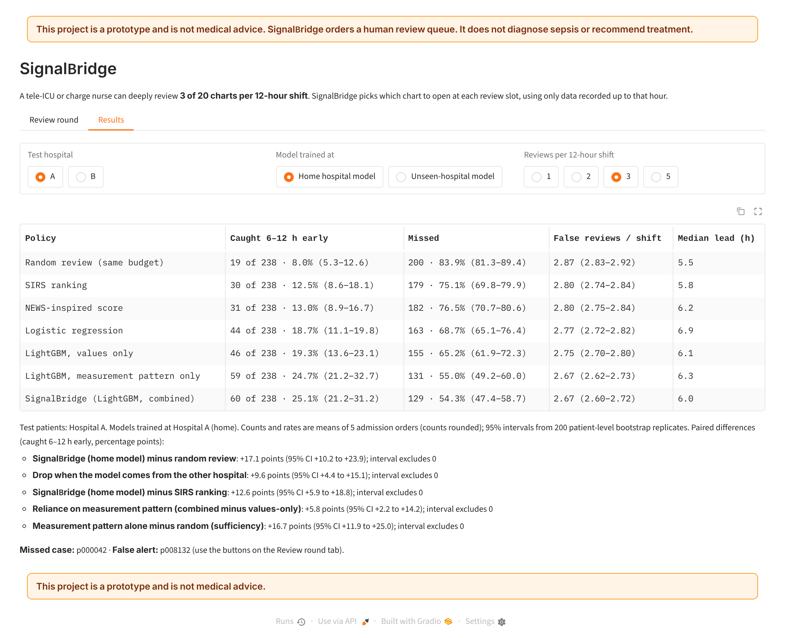

# SignalBridge

**A safety-aware sepsis review queue for a capacity-limited ICU.**
Veritas AI International High School Hackathon 2026 · AI + Health track ·
Team: Miheer Parasnis, Aaron Qin, Reyansh Maheshwari.

> **This project is a prototype and is not medical advice.**
> SignalBridge does not diagnose sepsis or recommend treatment. It only
> orders a human review queue.


## The problem and the user

A tele-ICU nurse or ICU charge nurse running a sepsis review round across 20
beds has time for about **3 deep chart reviews per 12-hour shift**. At each
review slot the question is: *of the patients I haven't just reviewed, whose
chart should I open now?* Sepsis alerts that fire on everyone are useless here.
A widely used commercial sepsis model, when validated externally, missed about
two-thirds of sepsis cases while alerting on 18% of hospitalizations (Wong et
al., *JAMA Internal Medicine*, 2021).

SignalBridge fills a fixed number of review slots using only data recorded up
to that hour, and explains each pick with a fixed-template "why now" line.

## Headline result

With 3 reviews per 12-hour shift, on test patients the model never saw:

| | Hospital A | Hospital B |
| --- | --- | --- |
| **SignalBridge, home model** | **25.1%** (21.2–31.2) · 60 of 238 | **26.3%** (19.8–33.8) · 35 of 134 |
| SignalBridge, model from the other hospital | 15.5% (12.1–21.0) | 23.7% (17.0–29.6) |
| SIRS ranking | 12.5% (8.6–18.1) | 16.9% (10.6–22.6) |
| Random review, same budget | 8.0% (5.3–12.6) | 9.3% (4.2–13.7) |

Share of eligible sepsis patients reviewed **6–12 hours before recorded onset**
(95% intervals from 200 patient-level bootstrap replicates).

- **Beats equal-budget random review:** +17.1 points at A (+10.2 to +23.9) and
  +17.0 at B (+10.3 to +25.3), paired inside each bootstrap replicate.
- **Beats SIRS:** +12.6 at A (+5.9 to +18.8) and +9.4 at B (+1.5 to +19.3).
- **Loses ground at an unseen hospital:** the B-trained model at A catches 9.6
  points fewer than the home model on the same patients (+4.4 to +15.1). The
  A-trained model at B drops 2.5 points, an interval that includes 0.
- **The measurement-pattern signal is strong but local.** A model that sees
  only *which* labs were measured and *when* (no values) matches the full
  model at home (A 24.7% vs 25.1%; B 26.3% vs 26.3%). Moved to Hospital A from
  B, its hourly AUROC falls from 0.754 to 0.582, while the values-only model
  falls only from 0.687 to 0.653; at Hospital B the two drops are similar.
  Sepsis onset in this dataset is partly defined from culture and antibiotic
  orders and from labs that must be drawn, so order patterns predict the
  label. We report this as a mechanism, not a discovery.
- **Most early catches came after a new round of labs appeared** (11 of 106 at
  A were ahead of new lab results). SignalBridge mostly prioritizes patients
  the record shows were already being worked up; it does not show the model
  beating clinicians.
- **False reviews stay high:** about 2.7 of every 3 reviews go to a patient
  with no onset in the next 12 hours (random: 2.9), because only ~6–9% of ICU
  patients develop sepsis.

These findings replicate known results about cross-hospital transfer and
missingness in this dataset. Our contribution is evaluating them as a
budgeted review decision.

Full results: **[docs/results.md](docs/results.md)**. Pre-registration
(committed before any test-set number): **[docs/preregistration.md](docs/preregistration.md)**.



## How it works

1. **Data:** PhysioNet/CinC Challenge 2019 training sets A (20,336 ICU
   patients) and B (20,000), hourly vitals and labs from two hospital systems.
   See [docs/data_provenance.md](docs/data_provenance.md).
2. **Labels:** onset = first `SepsisLabel = 1` hour + 6. The model learns
   "onset within the next 12 hours", the same window that defines a correct
   review. Patients already labelled in their first hour (426) are excluded
   from training and timing metrics, because no 6-hour warning is possible.
3. **Splits:** 70/15/15 by patient within each hospital, stratified, seed
   2026. Four comparisons: A→A, B→B, A→B, B→A, with the external model always
   compared with the home model on the same test patients.
4. **Features, past rows only:** carried-forward values (stale after 6 h for
   vitals, 24 h for labs), changes since the previous real measurement,
   6-hour vital-sign windows, shock index, age, sex. Gaps are filled with a
   draw from the training hospital's real values, so no NaN or constant
   "missing" value reaches the model. ICU length of stay, admission time and
   unit fields are excluded (shortcut ablation only).
5. **Models:** logistic regression, LightGBM on values only, measurement
   pattern only, and combined (the deployed candidate). Selection by home
   validation PR-AUC.
6. **Review-slot simulation:** every test patient passes once through a
   20-bed unit in a shuffled admission order; each 12-hour shift has 3 slots
   (hours 0, 4, 8); each policy picks one patient per slot, skipping anyone
   reviewed in the last 12 hours. All policies face the same beds at the same
   moments. This is a capacity-stress simulation, not a real ward census.
7. **Statistics:** mean of 5 admission orders; 200 patient-level bootstrap
   replicates (resample patients, new admission order, all policies on the
   same replicate); paired differences.

## Run it

```bash
pip install -r requirements.txt
python scripts/01_audit.py --download   # PhysioNet files, audit, splits (~15 min)
make reproduce                          # train, evaluate, secondary, app artifacts, tests
python app/app.py                       # http://127.0.0.1:7860 (add --share for a public link)
```

Or open [notebooks/reproduce.ipynb](notebooks/reproduce.ipynb) in Colab and
run all cells. Expected runtime: about 1 hour on a 2-core, 8 GB machine. The
app only reads `app/artifacts/`, so it runs offline and cannot change any
result. Exact package versions: `requirements-lock.txt`.

```
src/        data_io, labels, splits, audit, features, simulation, utility, explanations
scripts/    01_audit → 02_train → 03_evaluate → 04_secondary → 05_app_artifacts → 06_report
tests/      leakage, splits, labels, slots, alert classes, utility, explanations (19 tests)
app/        Gradio app and its precomputed artifacts
docs/       results, pre-registration, data provenance
vendor/     official PhysioNet 2019 scoring code (BSD-2)
```

## Acceptance tests (all pass)

- No future leakage: features at hour h are identical on the full record and
  on the record cut at h (200 real patients).
- No patient in two splits; sepsis share within 1 point across splits.
- Target is 1 only in the 12 hours before onset; nothing at or after onset
  in training; uncertain-onset patients absent from training.
- No NaN reaches any model; no values-only column repeats one value in >50% of rows.
- Exactly k reviews per full shift; no patient reviewed twice within 12 hours;
  identical bed schedule across policies.
- Toy patient with onset at hour 20: reviews at 5, 10, 16, 22 classify as
  false, early 6 h+, early, late.
- Null check: LightGBM on shuffled labels catches 9.0%, inside random's 5.3–12.6%.
- Too-good check: best portable internal AUROC 0.784 (alarm at 0.95).
- Vectorized utility equals the official Challenge code on 300 random patients.

## Limitations and claims we do not make

- Retrospective data from two hospital systems; never deployed, no outcome
  evidence. We do not claim it saves lives or works at any hospital.
- Onset comes partly from clinician orders, so a positive result shows
  flagging before the dataset's recorded onset, not before clinicians.
- Lab times are result times, not order times.
- Virtual units mix patients who were never in the ICU together.
- Values-only carry-forward still leaks some timing information, so reliance
  on measurement patterns is, if anything, underestimated.
- Several labs (HCO3, chloride, base excess, PTT) are recorded at very
  different rates by the two hospitals but were kept under the frozen rule.
- Race is not in the data; subgroup intervals are wide.

## Sources

- Reyna MA et al. *Early Prediction of Sepsis from Clinical Data: The
  PhysioNet/Computing in Cardiology Challenge 2019* (v1.0.0). PhysioNet,
  CC BY 4.0. https://doi.org/10.13026/v64v-d857
- Reyna MA et al. Early Prediction of Sepsis From Clinical Data: The
  PhysioNet/Computing in Cardiology Challenge 2019. *Critical Care Medicine*
  48(2):210–217 (2020). https://doi.org/10.1097/CCM.0000000000004145
- Challenge scoring code: https://github.com/physionetchallenges/evaluation-2019 (BSD-2)
- Wong A et al. External Validation of a Widely Implemented Proprietary
  Sepsis Prediction Model in Hospitalized Patients. *JAMA Internal Medicine*
  181(8):1065–1070 (2021).
- Singh J, Sato M, Ohkuma T. On Missingness Features in Machine Learning
  Models for Critical Care. *JMIR Medical Informatics* 9(12):e25022 (2021).
- Libraries: LightGBM, scikit-learn, pandas, NumPy, PyArrow, Matplotlib, Gradio, pytest.

## AI assistance

Code, analysis scripts and documentation were drafted with Claude
(Anthropic) during the hackathon weekend and reviewed by the team. Planning
documents were drafted with Claude and ChatGPT. All results come from the
code in this repository.

> **This project is a prototype and is not medical advice.**
